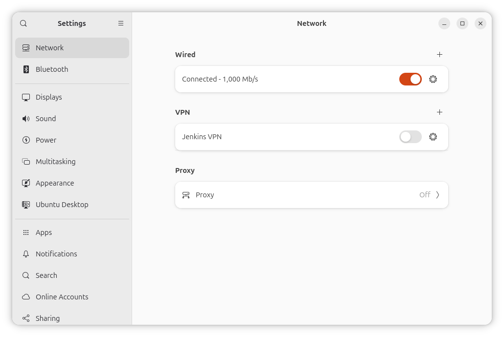
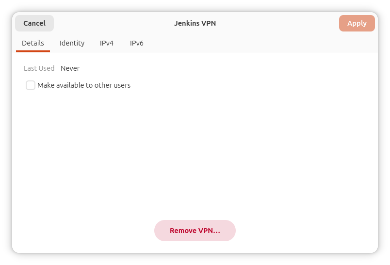
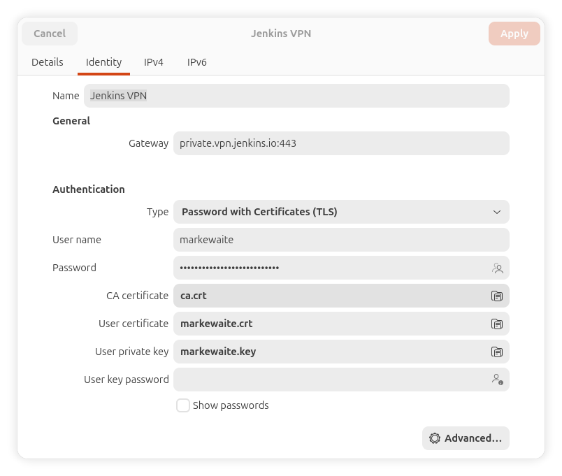
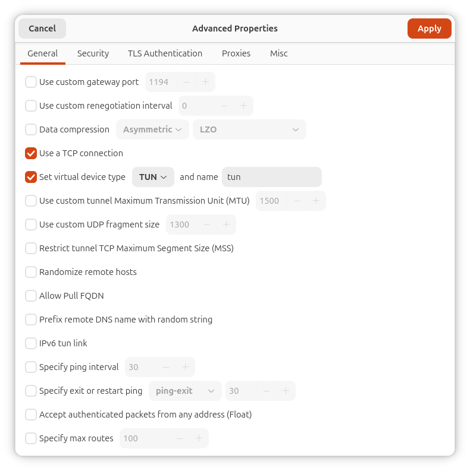
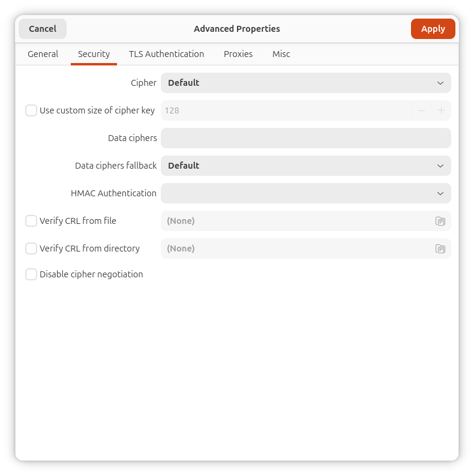
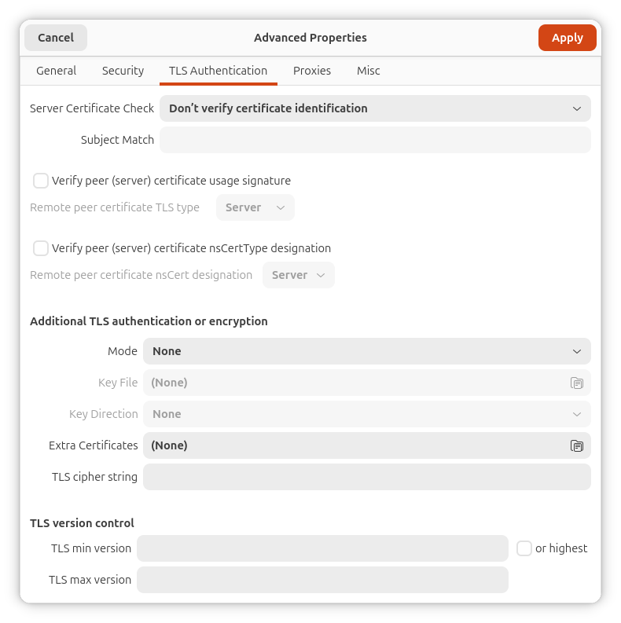
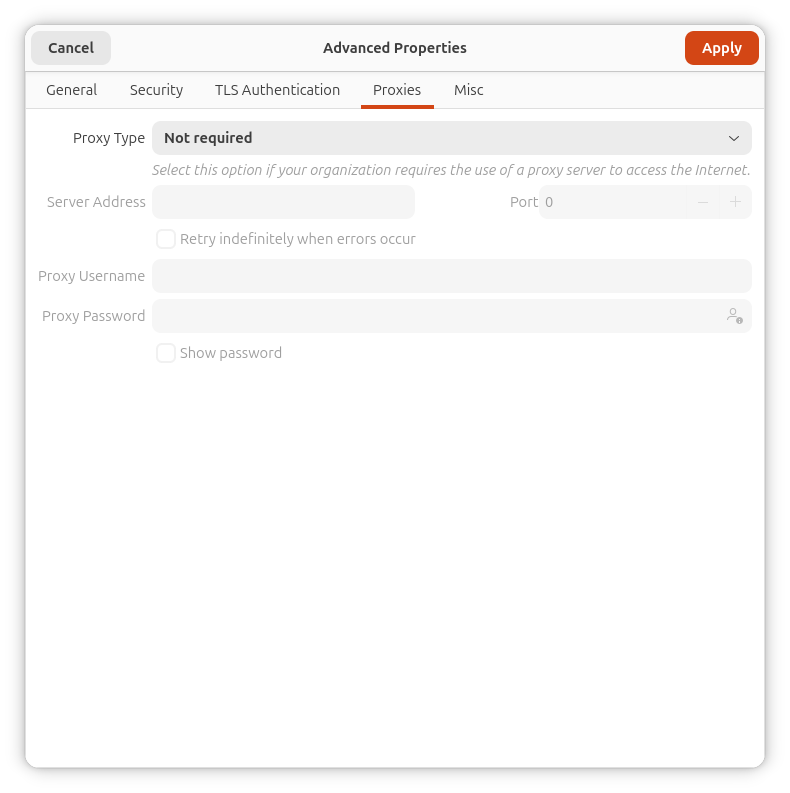
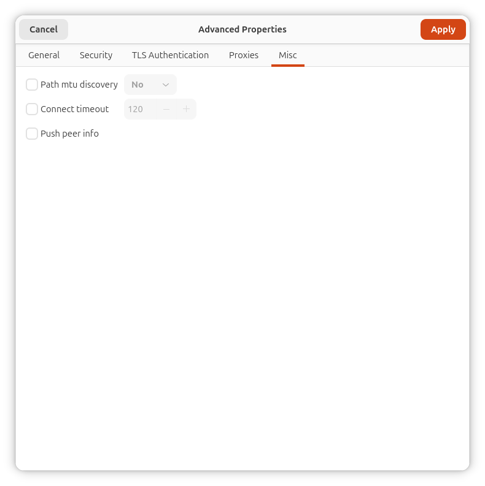
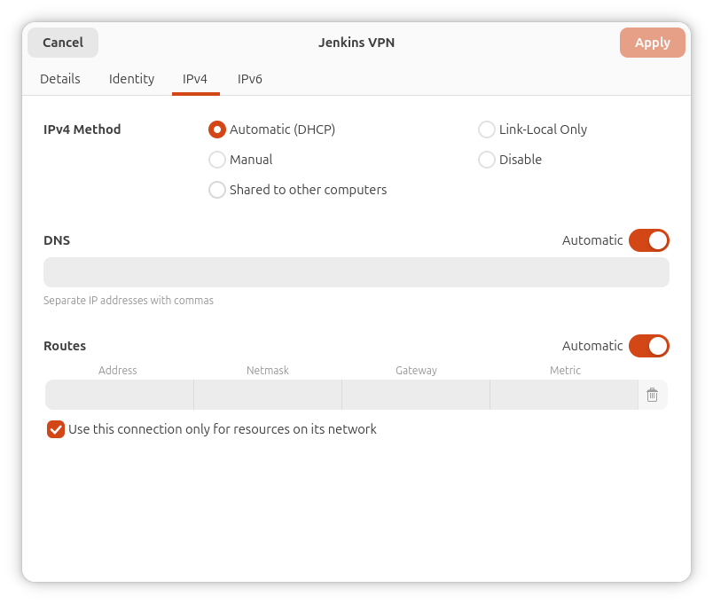
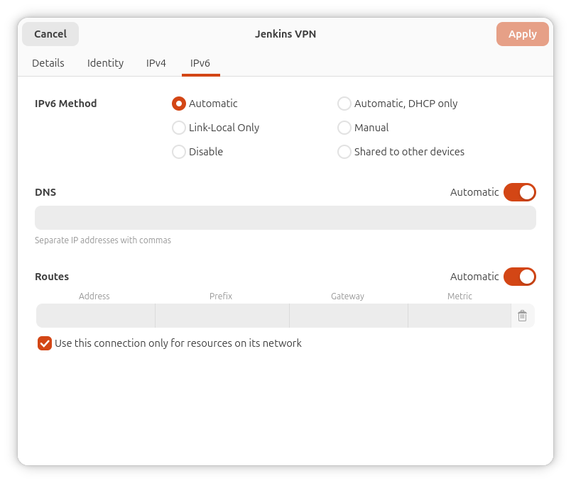

# Network Manager configuration with Ubuntu 26.04

Mark Waite configured his OpenVPN with Ubuntu 26.04 and took the following screenshots.  Your configuration may need to be different.  This worked for him.

## Network Settings

From the network icon in the top right corner of the screen, the arrow on the "VPN" button leads to "VPN Settings".

## Details

Clicking the gear icon on the Network settings page leads to the Details window that looks like this:

## Identity

Clicking the Identity tab shows a window that I configured with my Jenkins account user name and password like this:

## Identity / Advanced / General

The "Advanced" button on the Identity tab leads to a series of tabs.  I configured the "General" tab like this:

## Identity / Advanced / Security

The "Advanced" button on the Identity tab leads to a series of tabs.  I configured the "Security" tab like this:

## Identity / Advanced / TLS Authentication

The "Advanced" button on the Identity tab leads to a series of tabs.  I configured the "TLS Authentication" tab like this:

## Identity / Advanced / Proxies

The "Advanced" button on the Identity tab leads to a series of tabs.  I configured the "Proxies" tab like this:

## Identity / Advanced / Misc

The "Advanced" button on the Identity tab leads to a series of tabs.  I configured the "Misc" tab like this:

## IPv4

Clicking the IPv4 tab shows a window that I configured with my Jenkins account like this:

## IPv6

Clicking the IPv6 tab shows a window that I configured with my Jenkins account like this:

